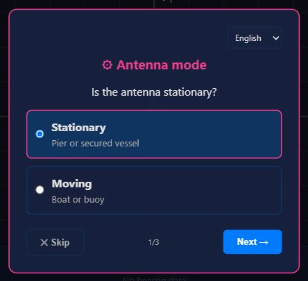
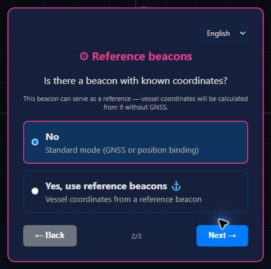
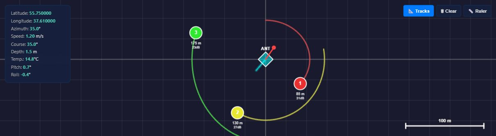
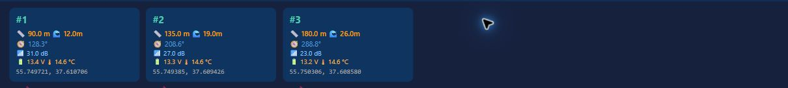
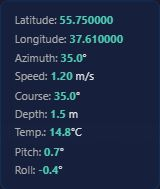
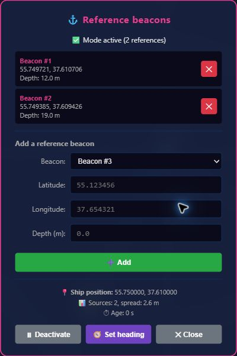
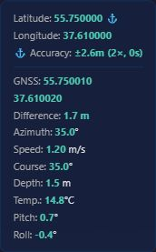
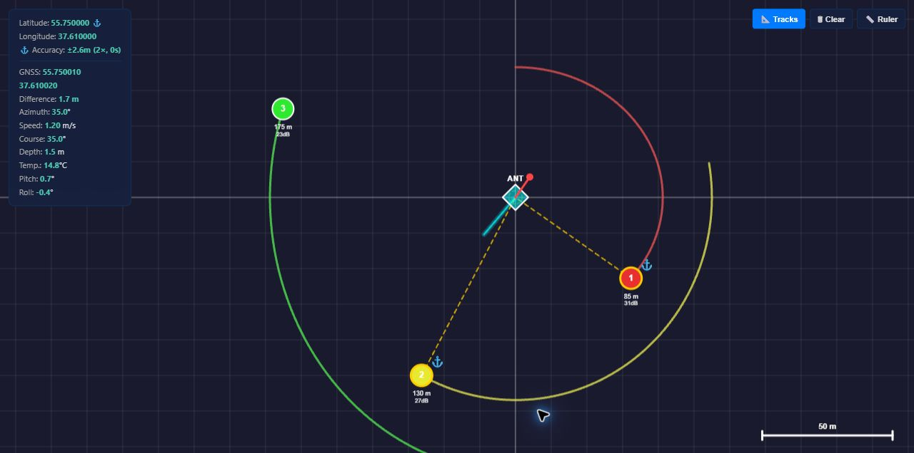

---

---

# AzimuthWebSuite User Guide

Version: [1.6.0](../CHANGELOG.md)

---

## Contents

1. [Introduction](#introduction)
2. [Installation and startup](#installation-and-startup)
3. [Interface](#interface)
4. [Connecting hardware](#connecting-hardware)
5. [Geographic positioning](#geographic-positioning)
6. [Reference beacon mode](#reference-beacon-mode)
7. [Working with beacons](#working-with-beacons)
8. [Tracks](#tracks)
9. [Calibration](#calibration)
   - [φ calibration using a known point](#φ-calibration-using-a-known-point)
   - [φ calibration by point cloud](#φ-calibration-by-point-cloud)
   - [Antenna calibration (correction table)](#antenna-calibration-correction-table)
10. [Points of interest (POI)](#points-of-interest-poi)
11. [Recording and playing logs](#recording-and-playing-logs)
12. [Log analysis](#log-analysis)
13. [Data export](#data-export)
14. [DRMS report](#drms-report)
15. [Ruler](#ruler)
16. [Themes](#themes)
17. [Settings](#settings)
18. [Keyboard shortcuts and gestures](#keyboard-shortcuts-and-gestures)
19. [File formats](#file-formats)
20. [Troubleshooting](#troubleshooting)


### φ calibration: antenna angular offset
### Antenna calibration: correction table


---

## Introduction

**AzimuthWebSuite** is a browser application for working with the **Zima2 USBL** underwater acoustic positioning system.

### Main use cases

- **Finding and tracking underwater objects** — transponder beacons fitted to ROVs, divers, or stationary objects
- **ROV navigation** — displaying position relative to the vessel in real time
- **Operating without GNSS** — determining the vessel position from reference beacons with known coordinates (⚓ mode)
- **Antenna calibration** — compensating for instrumental errors in the USBL antenna
- **Accuracy analysis** — calculating DRMS from beacon tracks
- **Documenting operations** — recording logs, exporting tracks, and marking findings as POI

### System requirements

- A Chromium-based browser (Chrome 89+, Edge 89+, Opera 75+)
- Web Serial API (enabled by default)
- A screen resolution of at least 480×800 (responsive layout)

---

## Installation and startup

### Online version

The upstream application is available at [docs.unavlab.com/AzimuthWebSuite](https://docs.unavlab.com/AzimuthWebSuite/).

This guide describes the English interface in the local localization branch. These localization changes have not been published to the upstream online version.

### Local startup

1. Download all files from the repository.
2. Place them in one folder, preserving the repository's subfolders.
3. Open `index.html` in your browser.

> No server is required. The application runs entirely on the client.

### Android

Use [UCNL Launcher](https://github.com/ucnl/UCNL_Launcher), a WebView wrapper with Web Serial API support.

---

## Interface

### Language

Use the **Language** selector in the top bar to choose **English** or **Русский**. The interface updates immediately without reloading the page. The selected language is saved in this browser and restored on the next launch.

For details about the translation catalogs and adding a language, see [Localization](localization.md).

### Setup wizard

The setup wizard opens automatically when the application is launched for the first time. It helps you quickly configure the antenna operating mode without going through every setting.

The wizard has two, three, or four steps, depending on the selected mode.

#### Step 1: Antenna mode

|  |
| :---: |
| _Setup wizard — choosing whether the antenna is stationary or moving_ |

- **Stationary** — the antenna is fixed, for example on a pier or a secured vessel. You can work in metric X, Y, Z coordinates without geographic positioning.
- **Moving** — the antenna is on a moving vessel. An external GNSS compass is required.

#### Step 2: Reference beacons

|  |
| :---: |
| _The wizard asks whether a beacon with known coordinates is available as a reference_ |

- **No** — use a standard operating mode (Geographic or Cartesian).
- **Yes, use reference beacons ⚓** — enables **⚓ Reference beacons** mode. The vessel position is calculated from a known beacon without GNSS. The wizard finishes immediately and opens the **⚓ Reference beacons** panel. To set the antenna heading, click **🧭 Set heading** in this panel; the positioning panel opens in **🧭 Heading only** mode.

> A reference beacon is a transponder beacon whose coordinates are **known precisely**, for example a beacon installed on the seabed at a known point or on a buoy with a known position.

#### Step 3a: Coordinates for a stationary antenna

If the antenna is stationary, the wizard offers these choices:

- **No**, with the hint **Work in X,Y,Z meters relative to the antenna** — enables Cartesian mode. The antenna is assumed to be at (0, 0, 0), and beacon coordinates are displayed in meters: X → right, Y → forward, Z → depth. Geographic positioning is not required.
- **Yes, enter them now** — enables Geographic mode and immediately opens the manual positioning panel for entering coordinates and heading.

#### Step 3b: GNSS compass for a moving antenna

If the antenna is moving, the wizard offers to connect an external GNSS compass:

- Select the **Port baud rate** (4800–115200 baud; default: 38400).
- Click **📡 Connect and check**.
- The status shows the connection result: **✓ Connected** or **✗ Disconnected**.
- Click **Done ✓** to finish setup.

#### Finishing setup

The final step includes **Do not show again**. If selected, the wizard will not open on subsequent launches.

To open the wizard again, choose **🔧 Tools → ⚙ Setup wizard**.

#### Operating modes

| Mode | Antenna | Beacon coordinates | Geographic positioning |
|---|---|---|---|
| Cartesian | Stationary (0,0,0) | X, Y, Z in meters | Not required |
| Geographic | From GNSS or entered manually | Latitude, longitude | Required |
| ⚓ Reference beacons | Calculated from a reference beacon | Latitude, longitude | Not required; a reference beacon is required |

#### Features available in each operating mode

| Feature | 🌍 Geographic | 📐 Cartesian | ⚓ Reference beacons |
|---|:---:|:---:|:---:|
| Beacon data | lat,lon,Z (depth) | X,Y,Z (meters) | lat,lon,Z (depth) |
| Geographic positioning | ✅ required (lat/lon + heading) | ❌ not required | 🧭 heading only (or GNSS) |
| GNSS compass | ✅ required (or manual positioning) | ❌ not required/ignored | ✅ needed for heading |
| GNSS position | ✅ used | ❌ ignored | ℹ️ displayed for comparison |
| Reference beacon | ❌ | ❌ | ✅ required (1+) |
| Beacon DH filter | ✅ | ✅ | ✅ |
| Vessel DH filter | ❌ | ❌ | ✅ |
| Beacon smoothing | ✅ | ✅ | ✅ |
| Station track | ✅ recorded and displayed | ❌ not recorded | ✅ recorded from the reference-derived position |
| Beacon tracks | ✅ recorded and displayed | ✅ recorded and displayed | ✅ recorded for tracked targets only |
| φ calibration: applying | ✅ | ✅ | ✅ |
| φ calibration: data collection | ✅ | ❌ | ❌ |
| φ calibration using a known point | ✅ | ❌ | ✅ |
| Table calibration: applying | ✅ | ✅ | ✅ |
| Table calibration: data collection | ✅ | ❌ | ❌ |
| POI | ✅ displayed | ❌ hidden | ✅ displayed |
| CSV export | ✅ lat,lon,Z (depth) | ✅ X,Y,Z | ✅ lat,lon,Z (depth) |
| GGA export | ✅ | ❌ | ✅ |
| KML export | ✅ | ❌ | ✅ |
| PSIMSSB export | ✅ | ✅ uses xM/yM | ✅ |
| PSIMSSB UTM export | ✅ | ❌ | ✅ |
| DRMS report | ✅ | ❌ | ✅ |
| Ruler | ✅ | ✅ | ✅ |
| Setup wizard | ✅ | ✅ | ✅ |

**📐 Cartesian mode** is intended for a stationary antenna without GNSS. It provides a quick start, coordinates in meters, and CSV export with XYZ.

**🌍 Geographic mode** is intended for a moving antenna with GNSS or a known geographic position and heading. It provides the full feature set.

### Top bar

|  |
| :---: |
| _Application top bar_ |

| Element | Description |
| :--- | :--- |
| Indicator | Green: connected; flashing yellow: interrogation active; red: disconnected |
| Device name | Zima2 USBL; after querying the device, its model and serial number. When a transponder beacon is connected, a **⚙** beacon settings button also appears |
| Status line | Current state or last action |

#### Controls

| Button | Purpose |
| :--- | :--- |
| 🎨 | Cycle through themes |
| 🔌/⏏ AZM | Connect/disconnect Zima2 |
| 📡/⏏ GNSS | Connect/disconnect an external GNSS compass |
| ▶/⏸ Interrogate | Start/stop beacon interrogation |
| ⚙ Settings | Open settings |
| 🔧 Tools | Menu: positioning, POI, calibrations, DRMS, coordinate converter |
| 📤 Export | Menu: CSV, GGA, PSIMSSB, KML |
| 📋 Log | Menu: save, open, analyze, play |

### Map

|  |
| :---: |
| _Map panel_ |

- **Center** — USBL antenna (diamond)
- **Direction** — red line from the antenna (heading)
- **Beacons** — colored circles with numbers
- **Grid** — cells with a fixed size in pixels; axes pass through the antenna center
- **Scale bar** — in the bottom-right corner

#### Controls

| Control | Purpose |
| :--- | :--- |
| **Tracks** | Toggle track display |
| **Clear** | Delete recorded tracks |
| **Ruler** | Enable/disable the distance measurement tool on the map |
| **Log playback progress** | Available only during log playback |
| **−** | Available only during log playback; decrease playback speed |
| **1x/2x/4x/8x** | Available only during log playback; current playback speed |
| **+** | Available only during log playback; increase playback speed |

### Beacon panel

|  |
| :---: |
| _Beacon panel_ |

Cards for all active beacons appear at the bottom of the screen:

- Number, range, azimuth, and depth
- Signal level (dB)
- Beacon battery voltage (V) and water temperature (°C)
- Coordinates, if geographic positioning is available
- Data age (s), indicated in green/yellow/red
- **📌** button to mark the current beacon position as a POI

Click a beacon card to center the map on that beacon and keep following it.

### Antenna information

|  |
| :---: |
| _Antenna card_ |

The card in the top-left corner of the map shows:

- Latitude and longitude
- Azimuth (Heading)
- Speed and course over ground (SOG/COG)
- Depth and water temperature
- Pitch/Roll angles

Click the antenna card to center the map on the antenna and keep following it.

---

## Connecting hardware

### Zima2 USBL

1. Connect Zima2 to a USB port, or through an RS-232/RS-422 converter.
2. Click **🔌 AZM**.
3. Select the port in the browser dialog.
4. Baud rate: **9600** baud by default.
5. The application automatically requests device information after connecting.
6. Beacon interrogation starts automatically after the information is received.

> **Important:** Do not disconnect power from Zima2 during interrogation. The indicator flashes yellow while interrogation is active.

### External GNSS compass

1. Connect the GNSS receiver to a second port.
2. Click **📡 GNSS**.
3. Select the port.
4. Default baud rate: **38400** baud, configurable in **⚙ Settings**.

**Supported NMEA 0183 messages:**

- `$xxRMC` — coordinates, speed, and course
- `$xxHDT` — true heading (preferred)
- `$xxHDM` — magnetic heading

---

## Geographic positioning

To display beacons in geographic coordinates, the antenna coordinates and heading must be known.

### Automatic positioning

When an external GNSS compass is connected, position and heading update automatically.

### Manual positioning

1. Open **🔧 Tools → 🌐 Manual positioning**.
2. Select a **Mode** at the top of the panel:
   - **🌍 Full (lat/lon + heading)** — sets antenna coordinates and heading; the standard option for `geographic` mode.
   - **🧭 Heading only (for ⚓)** — sets only the heading; coordinates will be calculated from reference beacons for `beacon_referenced` mode.
3. Enter:
   - **Latitude** in degrees, -90…+90; only in Full mode.
   - **Longitude** in degrees, -180…+180; only in Full mode.
   - **Heading** in degrees, 0…360; in either mode.
4. Click **✓ Apply**.

> In **⚓ Reference beacons** mode, the panel automatically opens in **🧭 Heading only** mode. Latitude and longitude fields are disabled and show the placeholder **(from references)**.

### Heading only mode

Use this option in **⚓ Reference beacons** mode when the antenna coordinates are unknown but its direction (heading) must be set.

**When to use it:**

- Debugging and evaluating accuracy in ⚓ mode
- A stationary antenna without a GNSS compass
- Holding the heading fixed to observe the spread of calculated vessel positions

**Procedure:**

1. Open the positioning panel either way:
   - **🔧 Tools → 🌐 Manual positioning**
   - Or click **🧭 Set heading** in the **⚓ Reference beacons** panel.
2. Make sure **🧭 Heading only (for ⚓)** is selected.
3. Enter the antenna heading (0–360°).
4. Click **✓ Apply**.

After applying:

- `antennaLatDeg / antennaLonDeg = NaN`; reference beacons will populate these values automatically.
- `antennaHeadingDeg` is set to the entered value.
- If the ⚓ panel was closed, it reopens automatically.

**What to observe:**

- **⚓ Accuracy** in the antenna panel: the spread of calculated positions, shown only with 2+ reference beacons.
- **Latitude/Longitude** in the antenna panel: coordinates calculated from reference beacons.
- The station track: built from the calculated position rather than GNSS.

> **A GNSS compass can also supply the heading.** Connect the receiver (**📡 GNSS**) to update the heading automatically. Heading only mode is useful when no GNSS compass is available but the antenna direction is known.

### Phone GPS

The **📱 GPS** button requests device geolocation, if the device has built-in GPS.

### Resetting positioning

The **🗑 Reset** button clears coordinates and heading.

---

## Reference beacon mode

|  |
| :---: |
| _Reference beacon control panel_ |

### Purpose

This mode is intended for operation **without GNSS** when the precise position of at least one transponder beacon is known. The vessel position is calculated from measurements to that beacon by solving the inverse positioning problem.

### When to use it

- The vessel has no GNSS receiver.
- Geographic positioning cannot be set up because the vessel position is unknown.
- A transponder beacon has **coordinates known in advance**, for example on the seabed at a known point or on a buoy with a known position.

### Quick start

1. On the first launch, choose **Yes, use reference beacons ⚓** in the setup wizard. The application switches to this mode and opens the **⚓ Reference beacons** panel. Alternatively, open it manually: **🔧 Tools → ⚓ Reference beacons**.
2. **Set the antenna heading.** Click **🧭 Set heading** in the ⚓ panel and enter the direction (0–360°) in Heading only mode. Alternatively, connect a GNSS compass using **📡 GNSS** in the top bar.
3. In the panel, select the **beacon address** from the interrogation mask, enter its **known coordinates** (latitude, longitude, depth), and click **➕ Add**.
4. Click **▶ Activate**.
5. Start beacon interrogation using **▶ Interrogate** in the top bar, or play a log using **📋 Log → ▶ Play**.
6. After the first measurement, the vessel position is calculated and displayed on the map. The **⚓** icon next to latitude in the antenna panel means the position is calculated from reference beacons.

> **Antenna heading is mandatory.** Without it, `strategyBeaconReferenced` cannot calculate the absolute bearing to the beacon, and the vessel position cannot be determined. Set the heading manually using 🧭 in the ⚓ panel, or connect a GNSS compass.

### Antenna panel contents

| Row | Description |
|---|---|
| Latitude / Longitude | **Vessel position** calculated from reference beacons |
| ⚓ Accuracy | `±X.Xm (N×, Ns)` — spread between reference-derived positions, number of sources, and age. **Shown only with 2+ reference beacons** |
| GNSS | **Only when GNSS data is available** in the log/port; shows the GNSS position |
| Difference | **Only when GNSS is available**; distance between the reference-derived position and GNSS position |
| Azimuth | Antenna heading from the compass |

|  |
| :---: |
| _Antenna panel showing reference-derived and GNSS positions_ |

### Position accuracy

- **1 reference beacon** — accuracy **is not estimated**. `spread = 0`, and **⚓ Accuracy** is **hidden**. Actual accuracy depends on USBL accuracy and how precisely the reference beacon coordinates are known.
- **2+ reference beacons** — `spread` is displayed: the spread between positions calculated from different beacons. **A smaller `spread` means greater agreement.**

### Configuring the vessel DH filter

Open **⚙ Settings → ⚓ Vessel filter (DH, reference beacon mode)**:

- **Max. vessel speed** (0.5–50 m/s; default: 2.0) — positions implying movement faster than this speed are discarded.
- **Rejected positions** are drawn on the map as gray crosses labeled **REJECTED**.
- **If the vessel position does not update**, increase **Max. vessel speed**.

### Map display

|  |
| :---: |
| _Map showing a reference beacon and the vessel track calculated from it_ |

- **Reference beacon** — highlighted with a **gold outline** and **⚓** next to its number
- **Dashed gold lines** — from each reference beacon to the vessel position
- **Spread circle** — around the vessel position with 2+ references; shows `spread`
- **Rejected position** — gray cross labeled **REJECTED**
- **Station track** — built from the calculated vessel position rather than GNSS

### Limitations

- **Antenna offsets** (`offsetX/offsetY`) **are not applied**, because there is no external reference point in this mode. Only the angular correction `phi` is applied.
- **Multiple reference beacons** are recommended for accuracy assessment. They should be **spaced apart** rather than close together; otherwise, position determination will be poorly conditioned.
- **Heading is mandatory.** Use an external compass (HDT/HDM/HDG), the built-in Zima2 compass, or manual entry through **🧭 Heading only** in the positioning panel.
- **Calibrations (φ and the antenna table)** — **data collection** is unavailable in this mode and requires `geographic`. **Applying** an already loaded table works.
- A **reference beacon** is not added to its own track; its coordinates are entered by the user and remain fixed.

### Common problems

| Symptom | Cause | Solution |
|---|---|---|
| Position does not update | DH filter rejects all positions | Increase **Max. vessel speed** in settings |
| Reference beacon jumps on the map | No anchor is set | Remove and add the reference beacon again |
| Accuracy is always ±0.0 m | Only 1 reference beacon | This is normal. Add a second beacon for an estimate |
| GNSS row is missing | No GNSS in the log/port | This is normal. The row appears when GNSS data is available |
| Beacon jumps far away after DH filtering | Threshold is too low | Increase **Max. vessel speed** |
| Position age is extremely large | Version bug | Update the application; fixed in 1.4.0 |
| Position does not update even though heading is set | Heading was entered in Full positioning mode | Switch to **🧭 Heading only** or clear the lat/lon fields |
| ⚓ panel closes after setting heading | Expected when heading is set from the ⚓ panel using 🧭 | The ⚓ panel returns automatically after applying heading. If it does not, open it manually through **🔧 Tools → ⚓ Reference beacons** |

---

## Working with beacons

### Address mask

Choose which beacons to interrogate in settings (addresses 1–16). Enter the mask as a number, the sum of its bits, or use the checkboxes.

### Display

- **Colored circle** — beacon within coverage
- **Gray cross** — point rejected by the filter
- **✕ icon** — timeout; no response for > 20 s
- **! icon** — stale data; > 8 s

### Beacon filter (DH)

Configure it in **⚙ Settings**:

- **Max. speed** — beacon points implying movement faster than this speed are discarded (0.5–5 m/s).
- The filter adapts to range: the threshold increases at longer distances.

### Coordinate smoothing

- At ranges **up to 1000 m** — a median filter with a 5-point window
- At ranges **over 1000 m** — no smoothing

---

## Tracks

### Station (antenna) track

The track is built automatically when GNSS data is available and appears as a light-blue line.

### Beacon tracks

Each beacon has its own track, shown as a colored line. Points are added after passing the DH filter.

### Track controls

| Button | Action |
|---|---|
| 📐 Tracks | Show/hide all tracks |
| 🗑 Clear | Delete all tracks, with confirmation |

### Track settings (⚙ Settings)

- **Max. points on screen** — track length limit (50–10000)
- **Min. distance** — minimum distance between points (0.1–50 m)

---

## Calibration

### φ calibration using a known point
**Purpose**: calculate the antenna angular offset (φ) from **a single beacon with known coordinates** and its accumulated track. This is the simplest, most accurate, and preferred method when a beacon can be placed stationary at a point with known coordinates.

**When to use it:**
- A transponder beacon with **precisely known coordinates** is available, installed on the seabed at a known point or on a buoy at a known position.
- A track of this beacon has already been accumulated; the beacon has been interrogated long enough.
- Geographic positioning has been performed for geographic, or ⚓ mode is active for `beacon_referenced`.

**Procedure:**
1. Accumulate the beacon track: start interrogation (▶ Interrogate) or play a log (📋 Log → ▶ Play). At least 3 track points are required.
2. Open 🔧 Tools → 🔧 Calibrations → 🔧 φ calibration (known point).
   - The application calculates DRMS for all tracks and opens the report window.
   - A 🔧 φ calibration using a known point section appears below the report.
3. If multiple tracks exist, select the desired **beacon** from the dropdown.
4. The section shows the **track centroid** — the average position of the accumulated beacon coordinates.
5. Enter the **actual beacon coordinates** (latitude and longitude).
6. Click **Calculate φ**. The application compares the bearing from the antenna to the centroid with the bearing to the actual point. The difference is φ.
7. Verify the result and click **✓ Apply φ**. The value is saved in settings and used when recalculating coordinates.
8. If needed, click **✓ Apply** in settings (**⚙ Settings → Apply**) so the new φ value takes effect for all beacons.

**How it works:**
- **Track centroid** — the averaged beacon position over the accumulated points, in `geographic`.
- **Actual point** — coordinates entered by the operator.
- **Bearing to centroid** — calculated from antenna coordinates.
- **Bearing to the actual point** — calculated from the same antenna coordinates.
- **φ** — the difference between these bearings, in degrees, −180…+180.

**Accuracy depends on:**
- **Accuracy of the beacon coordinates** — if the actual point is known with error, φ will be off by the same error.
- **Accuracy of the antenna coordinates** — if geographic positioning is coarse, the bearing is calculated inaccurately.
- **Number of track points** — more points give a more accurate centroid.

>**Tip**: if multiple beacons with known coordinates are available, run the calibration for each and compare the resulting φ values. Close values confirm the calibration is correct.

>**Limitation**: in 📐 Cartesian mode (stationary antenna at (0, 0, 0)), this calibration is unavailable, since there are no geographic coordinates for bearing calculations. It works in 🌍 Geographic and ⚓ Reference beacons modes when antenna and beacon coordinates are available.

**Access via menu: 🔧 Tools → 🔧 Calibrations → 🔧 φ calibration (known point)**

### φ calibration by point cloud

**Purpose:** compensate for the angle between the antenna zero direction and the vessel centerline.

**Procedure:**

1. Open **🔧 Tools → 🔧 Calibrations → 🔧 φ calibration (point cloud)**.
2. Set the parameters:
   - **Start angle/End angle** — search range, usually 0°–360°.
   - **Step** — fitting precision, usually 1°.
   - **Points** — maximum number of measurements, usually 100.
3. Click **▶ Start**.
4. Maneuver the vessel, circling the beacon or moving along a straight line.
5. Point collection stops automatically at the limit, or click **⏹ Stop**.
6. Confirm that the φ value should be applied.

**How it works:** tries φ values at the specified step, calculates DRMS for the beacon point cloud for each value, and selects the φ with the lowest DRMS.

> **Important:** φ calibration can use either of two arrangements. In the first, the beacon is stationary and the vessel maneuvers so that the beacon is observed at different angles. In the second, the antenna must be stationary and the beacon must move to cover the widest possible range of angles.

### Antenna calibration: correction table

**Purpose:** build an antenna correction table as a function of encoder angle (0°–360°).

**Procedure:**

1. Open **🔧 Tools → 🔧 Calibrations → ⚠📡 Antenna calibration (table)**.
2. Set the **Angle step**, usually 1°–5°.
3. Click **▶ Start**.
4. Maneuver the vessel around the beacon in a circle, or rotate the antenna in place.
5. Watch the point counter and centroid.
6. After collecting enough points, click **🔨 Build**.
7. If coverage is sufficient, click **✓ Apply**.
8. Alternatively, save the table to CSV using **💾 Download**.

**How it works:**

- Collects points: heading, measured azimuth, and coordinates
- Calculates the centroid, the arithmetic mean of beacon coordinates
- Calculates the true bearing to the centroid for each point
- Groups errors by encoder sector
- Averages errors in each sector
- Applies the table through AntennaCorrector

> **Requirements:** geographic positioning (coordinates and heading), a stationary beacon, and a maneuver covering different angles.

### Loading a calibration table

In **⚙ Settings → 📏 Antenna offsets → Calibration**:

- **📂 Load** — load the table from a CSV file.
- **🗑 Reset** — clear the table.

---

## Points of interest (POI)

**Purpose:** save points on the map for navigation and documentation.

### POI types

- **📍 Loaded** — imported from CSV, such as target points for an ROV
- **⭐ Marked** — saved by the operator during work

### Loading POI from CSV

1. Choose **🔧 Tools → 📍 POI → 📂 Load from CSV**.
2. Select a file with columns in this order: name, latitude, longitude, depth. See the [POI CSV example](#poi-csv).
3. POI appear on the map as pins (📍).

### Marking the current beacon position

Click **📌** on the beacon card. A POI is created with the beacon coordinates and the time it was marked.

### Exporting POI

- **💾 Save to CSV** — the complete POI list.
- **🗺 KML** — POI are included in KML together with tracks; loaded POI use a yellow pin and marked POI use a star.

### Clearing POI

- **🗑 Clear all** — deletes all POI, with confirmation.
- POI persist between sessions in `localStorage`.

---

## Recording and playing logs

### Recording a log

Recording starts automatically when connected to Zima2. All incoming and outgoing messages are recorded.

### Saving a log

- **📋 Log → 💾 Save** — download the log file.
- When disconnecting from Zima2, the application offers to save the log if it contains more than 10 entries.

### Loading and playback

1. **📋 Log → 📂 Open** — load a log file (.log/.txt).
2. **📋 Log → ▶ Play** — start playback.
3. During playback:
   - All functions remain available: tracks, beacons, and calibration.
   - Speed controls: **−** / **1x** / **+** (1x, 2x, 4x, 8x).
   - The progress bar shows the current position in the log.
4. **⏹ Stop** — end playback.

> The **log format** is compatible with AzimuthSuite (C#).

---

## Log analysis

**📋 Log → 🔍 Analyze**

Displays statistics for the loaded log:

- Number of entries
- Beacon statistics: successful responses and timeouts
- Compass data: minimum/maximum heading and anomaly detection

The **📋 Copy** button copies the report to the clipboard.

---

## Data export

All formats are available through **📤 Export**.

### CSV

Beacon and station tracks in tabular form: time, coordinates, depth, range, and azimuth.

### NMEA GGA (Beacon)

Emulates a GPS receiver for each beacon. Beacon identifiers are `B01`…`B10` (hex).

### NMEA GGA (Antenna)

Antenna track in GGA format. Duplicates are filtered at distances < 10 cm.

### NMEA PSIMSSB (Head-Up)

Beacon coordinates relative to the antenna: X, Y, Z in meters. Compatible with the HiPAP format.

### NMEA PSIMSSB UTM

Absolute beacon coordinates in the UTM projection (Easting, Northing).

### KML

Beacon and station tracks for Google Earth/QGIS. Includes POI if available.

---

## DRMS report

**Purpose:** assess beacon positioning accuracy.

**🔧 Tools → 📊 DRMS report**

Calculates the following for each beacon:

- **DRMS** (Distance Root Mean Square) — root mean square deviation
- **2DRMS** — twice DRMS (approximately a 95% confidence interval)
- **3DRMS** — three times DRMS (approximately a 99% confidence interval)
- **σX, σY** — standard deviations along the axes
- **Centroid** — arithmetic mean of coordinates

**Report format:**

```text
Beacon #1: DRMS=1.23m, 2DRMS=2.46m, 3DRMS=3.69m, σX=0.87m, σY=0.87m, points=342
```

The **💾 Download CSV** button saves the complete table, including centroid coordinates.

> **φ calibration using a known point**: below the DRMS report (only in **🌍 Geographic** and **⚓ Reference beacons** modes) a section appears for calculating φ from a beacon with known coordinates. See φ calibration using a known point.

---

## Ruler

Measures distances on the map.

1. Click **📏 Ruler**.
2. Click the first point on the map.
3. Move the mouse; a line follows the pointer and displays the distance.
4. Click the second point.
5. Click again to start a new measurement.

The ruler recalculates when the map is panned or zoomed during measurement.

---

## Themes

Use **🎨** to cycle through the themes.

| Theme | Description |
|---|---|
| Indoor | Dark blue, for indoor use; default |
| Light | Light theme, for bright sunlight |
| Dark Contrast | Black background with bright accents |
| Jack Black | Black background, white text, gray accents |
| Jack White | White background, black text, gray accents |
| VAX | Green text on black, styled after VAX/VT terminals |

---

## Settings

**⚙ Settings** opens a modal window with the following sections.

### Interrogation settings

- **Address mask** — which beacons to interrogate (1–65535)
- **Max. range** — interrogation range limit (100–5000 m)
- **Salinity** — used to calculate sound speed (0–40 PSU)
- **Sound speed** — entered manually or calculated automatically from temperature and salinity

### GNSS compass

- **Compass mode** — Auto (prefer HDT), HDT only (True), or Magnetic only
- **Baud rate** — 4800–115200 baud

### Antenna offsets

- **X, Y** — linear antenna offset from the vessel's point of rotation, in meters
- **Antenna φ** — angular offset in degrees
- **Calibration** — load/reset a calibration table

### Antenna mode

- **🌍 Geographic** — standard mode with geographic positioning: antenna coordinates and heading.
- **📐 Cartesian (stationary)** — the antenna is assumed to be at (0, 0, 0); beacon coordinates are in meters: X → right, Y → forward, Z → depth.
- **⚓ Reference beacons** — vessel position is calculated from known reference beacon coordinates without GNSS/geographic positioning. See [Reference beacon mode](#reference-beacon-mode).

### Beacon filter (DH)

- **Max. speed** — filter threshold (0.5–5 m/s)

### Vessel filter (DH, reference beacon mode)

This subsection appears when **⚓ Reference beacons** mode is active. It controls the vessel position filter, rejecting physically impossible movement.

- **Max. vessel speed** — filter threshold (0.5–50 m/s; default: **2.0**). Positions implying movement faster than this speed are discarded.
- **Rejected positions** — drawn on the map as gray crosses labeled **REJECTED**, for diagnostics.
- **If the vessel position does not update**, increase **Max. vessel speed**.

### Beacon tracks

- **Max. points on screen** — track length limit (50–10000)
- **Min. distance** — track thinning distance (0.1–50 m)

---

## Keyboard shortcuts and gestures

### Mouse

| Action | Result |
|---|---|
| Mouse wheel | Zoom the map |
| Drag | Pan the map |
| Double-click the map | Reset the view to the antenna (scale 100) |
| Click a beacon | Follow the beacon |
| Click the map | Stop following |

### Touch

| Action | Result |
|---|---|
| One finger | Pan |
| Two fingers | Pinch to zoom |
| Double tap | Reset the view to the antenna |
| Tap a beacon | Follow the beacon |

---

## File formats

### Communication log (.log)

```text
16:05:59.141: INFO: COM17 (GNSS) >> $GPGGA,050558.85,4637.143860,N,14242.139534,E,0,28,1.2,00021.270,M,00000.000,M,2.0,*78
16:05:59.225: INFO: COM17 (GNSS) >> $GPRMC,050558.85,A,4637.143860,N,14242.139534,E,2.2,65.8,280426,,,D*6C
16:05:59.225: INFO: COM17 (GNSS) >> $GPHDT,66.8,T*0D
16:05:59.435: INFO: COM44 (AZM) >> $PAZM3,1,0,0,38,23.8,0.080975,115.3,113.0,22.8,325.8,11.4,1147.22,4.5,,2.6,-2.9*0E
...
```

### POI (.csv)

The original CSV header is retained below. Import reads columns by position rather than by header name, so a header such as `Name,Latitude,Longitude,Depth` is also accepted. Depth can be omitted.

```csv
Название,Широта,Долгота,Глубина
Approach point,55.123456,37.654321,15.5
Object A,55.345678,37.876543,
```

### Calibration table (.csv)

```csv
# Angle_deg;Error_deg
5.000;1.234567
15.000;2.345678
```

### DRMS report (.csv)

```csv
Beacon,Points,DRMS_m,2DRMS_m,3DRMS_m,SigmaX_m,SigmaY_m,CentroidLat,CentroidLon
1,342,1.234,2.468,3.702,0.872,0.873,55.12345678,37.65432190
```

## Troubleshooting

### Cannot connect to Zima2

- Make sure another application is not using the port.
- Check the baud rate; it must be 9600 baud.
- Try reconnecting the USB cable.
- Reload the page.

### Beacons are not displayed

- Check the address mask in settings.
- Make sure the beacon is within coverage: range < maximum range.
- Check that interrogation is active; the indicator should flash.

### Beacons have no coordinates

- Set up geographic positioning manually or connect GNSS.
- Coordinates appear only after the point passes the DH filter.

### The application slows down during log playback

- Reduce playback speed to 1x.
- Hide tracks using **📐 Tracks**.
- Close panels you are not using.

### Calibration produces no result

- Make sure the beacon is stationary.
- Collect more points at different headings.
- Check geographic positioning.
- Increase the angle step when building the table.

### Position does not update in Reference beacons mode

- Check that a **reference beacon has been added** in **🔧 Tools → ⚓ Reference beacons**.
- Check that **antenna heading is not NaN**; calculation is impossible without heading. Connect a GNSS compass or check the built-in Zima2 compass.
- Check that the **beacon is being interrogated**. Its address must be included in the **Address mask** under **⚙ Settings → 📡 Interrogation settings**, and interrogation must be **active** using **▶ Interrogate**.
- Increase **Max. vessel speed** under **⚙ Settings → ⚓ Vessel filter (DH, reference beacon mode)**. If the threshold is too low, the DH filter rejects all positions.
- **Rejected positions** appear as gray crosses labeled **REJECTED**. Many such crosses indicate that the threshold is too low.

### A reference beacon jumps on the map

- The **anchor** (world reference point) is probably **not set**. Remove the reference beacon and add it again; adding a beacon sets the anchor automatically.
- Alternatively, switch to **Geographic** mode and back, or **restart playback**; `togglePlayback` also sets the anchor.
- Check that the reference beacon's **`ref.lat/ref.lon`** values are entered **correctly**, for example in the reference beacon panel.

### Accuracy is always ±0.0 m

- This is **normal** with **one** reference beacon. `spread = 0` by definition, and **⚓ Accuracy** is hidden in the antenna panel.
- **Accuracy assessment** requires **2+** reference beacons. The farther apart they are, the more informative `spread` becomes.

### The GNSS row is missing from the antenna panel

- This is **normal** when there is **no GNSS data** in the current log/port. The **GNSS** row appears **only** when data is available.
- If GNSS **is available** but the row is missing, check that **⚓ Reference beacons** mode is active and GNSS messages are **being parsed** (`$xxRMC`).

### Vessel position age shows billions of seconds

- This is a **bug** in versions **before 1.4.0**: virtual Playback time was compared with real `Date.now()`.
- **Solution:** update the application to **1.4.0** or later.

### φ or table calibration does not work in Reference beacons mode

- Calibration **data collection** is **unavailable** in this mode. It requires full `geographic` mode with antenna coordinates from GNSS/manual positioning.
- **Applying** an already loaded table/φ works. Load it beforehand in `geographic`, save it in settings, and switch to `beacon_referenced`.

### The station track breaks after leaving Reference beacons mode

- Check **`TrackManager.getAnchor()`**. If it still contains reference beacon coordinates, they should **reset** on the next GNSS update.
- If they **do not reset**, reload the page or explicitly switch to `geographic`.

## Additional links

- [📋 Version history (CHANGELOG)](../CHANGELOG.md)
- [⭐ GitHub repository](https://github.com/ucnl/AzimuthWebSuite/)
- [⚖️ GNU GPL v3.0 License](https://github.com/ucnl/AzimuthWebSuite/blob/main/LICENSE)
- [Localization](localization.md)
- [Russian user guide](guide.md)

© 2026 [UC&NL](https://unavlab.com)
